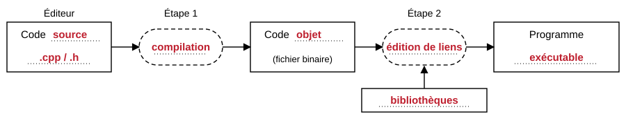

## Pourquoi apprendre le C++ ?

Le C++ est un langage <ins>rapide</ins>, <ins>flexible</ins> et <ins>portable</ins>. Il permet deux paradigmes de programmation : <ins>procédural</ins> et <ins>orienté objet</ins>. Son principal inconvénient : <ins>sa complexité, qui impose de la rigueur et de la méthode</ins>.

| Date | Événement | Date | Événement |
| --- | --- | --- | --- |
| **1979** | <ins>Bjarne Stroustrup</ins> crée « C with Classes » | **1998** | Première norme : <ins>C++98</ins> |
| **1983** | Le langage est rebaptisé <ins>C++</ins> | **2011** | <ins>C++11</ins> : début du C++ moderne |

> [!NOTE]
> Un fichier d'en-tête déclare ce qu'une bibliothèque offre ; il ne contient pas son code.

## Du code source au programme

*Compléter les cases vides du schéma.*



Le code source est écrit dans un langage de <ins>haut</ins> niveau, pensé pour les <ins>humains</ins>. Le code objet est un code de <ins>bas</ins> niveau, destiné à <ins>la machine</ins>. L'éditeur de liens <ins>assemble</ins> le code objet avec les <ins>bibliothèques</ins> utilisées et crée le programme.

> [!TIP]
> Compiler avec `g++ -Wall -Wextra` révèle déjà la moitié des erreurs d'étourderie.

## Premier programme

```cpp
#include <iostream>
using namespace std;

// Le point d'entrée du programme.
int main() {
    int <ins>age</ins>;
    cout << "Quel <ins>âge</ins> as-tu ? ";
    cin >> <ins>age</ins>;
    cout << "Tu as " << age << " ans." << endl;
    return 0;
}
```

> [!IMPORTANT]
> Une directive de préprocesseur, comme `#include`, ne se termine pas par un point-virgule.

Pour le compiler puis l'exécuter, on saisit dans le terminal :

```terminal
$ g++ -Wall -o <ins>age</ins> age.cpp
$ ./age
Quel âge as-tu ? 17
Tu as 17 ans.
```

*Que signifient les options `-Wall` et `-o` de la première commande ?*

<ins lignes="2">`-Wall` demande au compilateur de signaler tous les avertissements ; `-o age` donne le nom `age` à l'exécutable produit.</ins>

> [!WARNING]
> `cin` laisse le retour à la ligne dans le tampon : une lecture de texte qui suit peut échouer.

*Que se passe-t-il si `age` n'est pas initialisé avant d'être lu ?*

<ins lignes="3">Un `int` non initialisé contient une valeur quelconque, restée en mémoire : le comportement du programme est imprévisible.</ins>

> [!CAUTION]
> Ne jamais lire une variable avant de l'avoir écrite.
